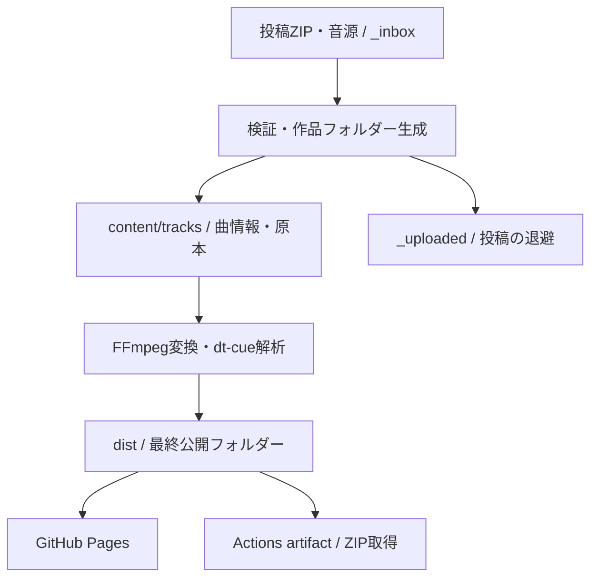

# ARCHIVE MUSIC

音を残す。音を見つける。

GitHub Actionsで音楽の作品フォルダーと最終公開フォルダーを構築する、静的な音楽投稿・試聴プラットフォームです。

公開サイト: https://xenoah.github.io/archive_music/

## できること

- 曲名・作者・タグ検索、ジャンル/BPM絞り込み、並び替え、お気に入り（端末内保存）
- 音楽再生、一時停止、シーク、前後曲、リピート、音量、曲への共有リンク
- dt-cue由来の3帯域全体波形、拡大、ビートグリッド、L/Rオシロスコープ、対数FFT
- dt-cueの発音間隔(IOI)・自己相関(ACF)・周期グリッド(COMB)によるBPM候補と合議結果
- 投稿フォームから音源・ジャケット・曲情報のZIPを作成
- `_inbox`の音源/フォルダー/ZIPをActionsが正規化し、`content/tracks/{slug}/`を生成
- 原本を`_uploaded`へ退避。再生用MP3、解析JSON、ジャケット、曲一覧を`dist`へ構築
- オリジナル音源のダウンロード表示を曲ごとに設定
- ローカル音源の試聴・ブラウザ内解析（アップロードなし）

初期状態には3つの**合成デモ音源**を収録します。投稿作品として偽装せず、画面上にもDEMOと明示しています。デモはビルド時に生成するため、リポジトリへバイナリをコミットしません。

## 投稿方法

### コマンドだけで投稿（推奨）

```bash
npm run upload -- "C:/Music/my-track.flac" --title "My Track" --artist "Xenoah" --genre "Electronic" --cover "C:/Music/cover.jpg"
```

音源を検証し、投稿フォルダーを作成して、そのフォルダーだけをcommit・pushします。通常のGit認証が必要です。他の作業中のファイルをコミットしません。初回は `git clone https://github.com/Xenoah/archive_music.git` → `cd archive_music`。`--prepare-only` ならファイル準備だけ、`--draft` は下書き、`--download` は原本DL表示、`--bpm 128` はBPM指定です。Windows PowerShellで実行ポリシーに止まる場合は `npm.cmd run upload -- ...` を使います。

同じ曲を編集するときは `content/tracks/{slug}/` を編集し、`git add` → `git commit` → `git push`。投稿のためにブラウザを開く必要はありません。

### ブラウザから

1. サイトの「投稿する」で音源・曲名・作者・公開状態・利用条件を入力。
2. 「投稿用ZIPを作成」で保存。
3. 「GitHubの投稿先を開く」から `_inbox` へZIPを追加し、**Commit changes**。
4. Actionsの **Import, build and publish music** が成功すると公開サイトへ反映。

ZIP保存だけでは公開されません。GitHubアカウントとリポジトリ書き込み権限が必要です。第三者からの投稿はfork → Pull Request → 管理者によるマージを利用できます。匿名の直接投稿、サーバーアカウント、公開コメント、共有再生数は実装していません。

GitHubのブラウザアップロードは1ファイル25 MiBまでなので、投稿フォームは音源＋画像の合計を24 MiBに制限します。これはZIPのヘッダー分も含めて余裕を確保するためです。

### Git / GitHub Desktopから

`_inbox/{slug}/` に次のファイルを配置してpushします。

```text
_inbox/my-track/
  track.json          # templates/track.json を複製して編集（省略も可）
  music.flac          # 1作品につき音源1つ
  cover.jpg           # 任意。PNG/JPEG/WebP
```

音源単体を `_inbox/song.mp3` に置いても取り込めます。音源タグから曲名・作者・アルバム・ジャンルを読み取り、未設定の作者はXenoahになります。ZIPはSTORE/DEFLATEに対応し、パス遡及、シンボリックリンク、暗号化、重複エントリー、異常な展開サイズを拒否します。

対応音源: **MP3 / WAV / FLAC / M4A / OGG / AAC / OPUS**。音源1つ95 MiB以下、長さ20分以内。ZIPは圧縮前後とも95 MiB以下、32エントリー以下です。Git LFSポインターや外部URL取り込みには対応しません。

### 編集・削除・下書き

- 取り込み後は `content/tracks/{slug}/track.json` を編集してpush。
- 原本を差し替えると解析キャッシュキーが変わり、再解析されます。
- 同じslugの再投稿はエラーで止まり、既存曲を上書きしません。
- 削除は対応する `content/tracks/{slug}/` フォルダーを削除してpush。次回ビルドで古い公開ファイルを除去します。
- `status: "draft"` はカタログ、音源、ジャケット、解析JSONのすべてを公開出力から除外します。
- **公開リポジトリにある原本・下書き・履歴はGitHubから閲覧できます。** 下書きはサイトの掲載制御であり、機密保管ではありません。
- `download: false` は原本の公開コピーとDLボタンを省略します。再生用音声は配信されるためコピー防止にはなりません。

## track.json

```json
{
  "slug": "my-track",
  "title": "My Track",
  "artist": "Xenoah",
  "album": "",
  "genre": "Electronic",
  "tags": ["original", "synth"],
  "description": "制作メモ",
  "license": "All rights reserved",
  "status": "public",
  "download": false,
  "createdAt": "2026-11-15",
  "bpm": null
}
```

`slug` は英小文字/数字から始まる80文字以下の英小文字・数字・`-`・`_`。省略時は曲名＋音源SHA-256の先頭8文字から生成します。`bpm` は40〜240またはnull（自動）。明示したBPMが公開表示とビートグリッドに優先します。画面のBPM候補選択・手動補正はその試聴セッションだけに適用され、GitHub上の値は変えません。

取り込み後には `audio: "original.ext"` と `cover: "cover.ext"` / null が自動設定されます。

## Actionsと生成物



```text
dist/
  index.html
  style.css
  catalog.json
  src/
  assets/
  music/{slug}/
    stream.mp3          # 44.1 kHz / stereo / 192 kbit/s
    analysis.json       # 波形、BPM候補、各方式の結果
    cover.jpg or .svg
    original.ext        # download=true のみ
```

公開フォルダーは相対パスで動作し、リポジトリ名やPagesのサブパスに依存しません。投稿先だけ `GITHUB_REPOSITORY` から設定します。

ワークフローは取り込み → ビルド → 取り込みコミット → artifact → Pagesを**同一実行**で行います。botのコミットは`[skip ci]`付きで再帰実行を避けます。PRワークフローは読み取り権限だけで検証し、公開・pushしません。

初回のPages有効化もコマンドで実行できます。GitHub CLIに `gh auth login` 済みの端末で `npm run setup:pages` を実行してください。Pagesの作成/更新後に公開ワークフローを起動します。未設定の間もActionsはビルド成果物を作成し、Pages公開だけをスキップします。画面で設定する場合は **Settings → Pages → Source → GitHub Actions**。`main`へのpushで起動します。Actionsの成果物 `archive-music-dist` は任意の静的Webサーバーへそのまま配置できます。

## ローカル開発

Node.js 22以上、FFmpeg/ffprobeをPATHに用意してください。npmパッケージのインストールは不要です。

```bash
npm test
npm run import
npm run build
npm run dev
```

http://localhost:3000/ を開きます。`--port` または `PORT` に対応。HTMLをfile://で直開きする使い方ではありません。

デモを除外する場合は `INCLUDE_DEMOS=false npm run build` を使います。生成済みデモも公開出力から除外します。これら3つのslugはデモ用に予約しています。

## 解析の内容と制限

- `dt-cue_precision-media-player` の `tempo.js`、`analysis-core.js`、`views.js`、`analysis-worker.js` をMITライセンス表記付きで同梱。
- 元コード固定コミット: `a6361e08a6c3644773ed5770544e175a7bee5820`
- 公開時の解析入力はFFmpegで24 kHz / stereo / Float32へ変換。帯域波形の境界は元コードどおり250 Hz・4 kHz。左右のエネルギーを別々に集計し、逆相による打ち消しを防ぎます。
- BPMは40〜240、0.25刻みの探索。最大8区間×24秒を評価し、3方式の候補を統合。無音・短い音源・周期が不明な音源は「不明」にします。
- リアルタイムFFTは再生中のWeb Audio AnalyserNodeを使用し、FFTサイズ4096、平滑化0.75、対数70バンド。24 kHzの事前解析PCMではなく、44.1 kHzの配信音源を解析します。
- BPMは推定であり、倍テン/半テン、変拍子、テンポ変化では候補確認と手動補正が必要です。信頼度の値はヒューリスティックな周期の強さで、正解確率ではありません。
- 公開音源はストリーミング再生し、曲全体をWeb Audioへデコードしません。ローカル試聴の全解析は40 MiB・10分まで。コーデック対応はブラウザによります。
- GitHub Pagesの容量・転送量制限内で運用する個人/小規模のアーカイブを想定しています。大規模な無制限音楽配信向けの構成ではありません。

## 出典・ライセンス

- フォルダー構築の構成参考: https://github.com/Xenoah/archive-3dmodels
- プレイヤー/解析元: https://github.com/Xenoah/dt-cue_precision-media-player
- プログラム: MIT。dt-cueの著作権表記を `site/src/vendor/dtcue/LICENSE` に保持。
- 各音楽作品: `track.json` の利用条件を参照。プログラムのMITは投稿作品に自動適用されません。
- GitHubのアップロード上限: https://docs.github.com/en/repositories/working-with-files/managing-files/adding-a-file-to-a-repository
