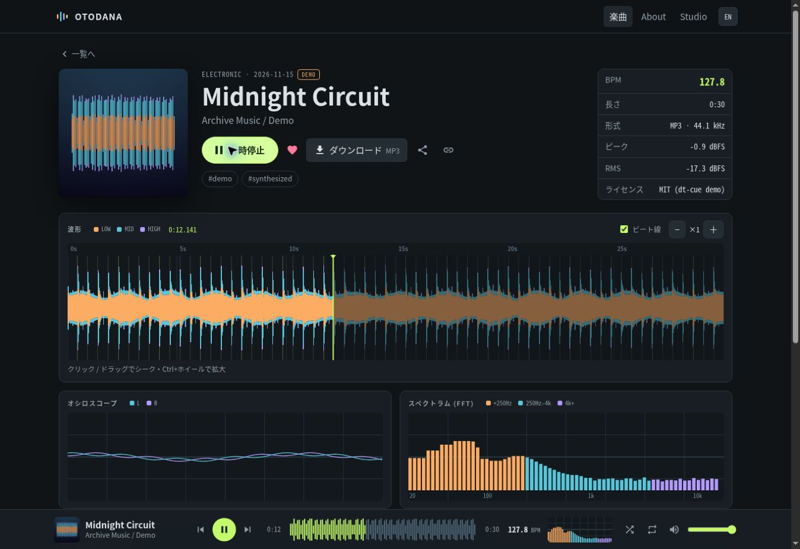

# OTODANA / archive_music

GitHub Actionsで作品フォルダーと最終公開フォルダーを構築する、音楽投稿・試聴プラットフォーム。
受領した **OTODANA** をメイン画面に統合し、従来のローカル試聴・ZIP作成画面を **Studio** に残しています。

公開先: https://xenoah.github.io/archive_music/



## 機能

- 曲別ページ `/t/{slug}/`、日英UI、ページ移動中も再生が続くプレイヤー
- タイトル・作者・タグ検索、ジャンル/BPM範囲、並び替え、お気に入り（端末内保存）
- 再生・シーク・音量・ミュート・前後曲・シャッフル・リピート・Media Session
- dt-cueの3帯域波形、拡大、ビートグリッド、L/Rオシロスコープ、対数FFT
- IOI・ACF・COMBの3方式によるBPM推定と候補表示、手動グリッド補正
- 事前解析した波形を最大2400点×4帯域の8bit配列に圧縮（デモのJSONは約15 kB）
- 波形から自動ジャケット生成、曲別OGP・JSON-LD、RSS・sitemap
- Studioでローカル音源を試聴・解析し、投稿用ZIPを準備

一覧・曲・About間は再生を維持します。Studioは独立した画面のため移動時に再生が止まります。説明文そのものは翻訳せず、投稿時の言語で表示します。
初期状態の3曲は動作確認用の**合成デモ**です。画面にDEMOと表示し、ビルド時に生成します。

## 投稿方法

Node.js 22以上、FFmpeg/ffprobe、Git認証を用意してください。npm依存パッケージはありません。

```bash
git clone https://github.com/Xenoah/archive_music.git
cd archive_music
npm run upload -- "C:/Music/my-track.flac" --title "My Track" --artist "Xenoah" --genre "Electronic" --cover "C:/Music/cover.jpg"
```

音源を検証し、`_inbox/{slug}/` を作成して、そのフォルダーだけをcommit・pushします。他の作業中ファイルはコミットしません。Actionsが取り込み・解析・ビルドを実行します。
Windows PowerShellで実行ポリシーに止まる場合は `npm.cmd` を使います。次回投稿前は `git pull --ff-only` でActionsの取り込みコミットを取得してください。

Markdown/JSONの曲情報もコマンドで指定できます。明示したCLIオプションが曲情報ファイルに優先します。

```bash
npm run upload -- "song.wav" --info "song.md" --bpm 128
```

| オプション | 動作 |
|---|---|
| `--info song.md` / `song.json` | 曲情報と説明文を読み込む |
| `--title` / `--artist` / `--album` / `--genre` / `--key` | 曲情報を指定 |
| `--tags "original,synth"` | カンマ区切りのタグ |
| `--tools "Suno,Claude,FLSM"` | 生成ツール（任意・複数指定可） |
| `--bpm 128` | BPM指定（20〜400）。省略は自動解析 |
| `--draft` | 公開フォルダーへ出力しない |
| `--hidden` | 曲URLからのみ閲覧。一覧・RSS・sitemapから除外 |
| `--download` | 原本へのダウンロードリンクを表示 |
| `--prepare-only` | ファイル準備のみ。commit・pushを省略 |

### 音源・フォルダー・ZIPの投入

`_inbox/` は以下を受け付けます。

- 音源単体。`song.wav` と同じ名前の `song.md` / `song.json`、`song.jpg` を並べても取り込めます。
- 1音源と任意の画像・曲情報を入れたフォルダー。
- 同じ構成のZIP。Studioで作成したZIPにも対応。

曲情報は `track.json`、`info.json`、Front Matter付きMarkdownの**いずれか1つ**、画像も1つまで。指定がない項目は音源タグ・設定の作者名を使い、画像がなければ埋め込みカバーを抽出し、それもなければ波形から生成します。

StudioでZIPを保存した場合も、アップロードはコマンドで行います。

```bash
# 保存したZIPを _inbox/ にコピーしてから実行
npm run import -- --dry-run
git add -- _inbox/my-song.zip
git commit -m "Add my song" -- _inbox/my-song.zip
git push origin main
```

取り込み対象は **MP3 / WAV / FLAC / M4A / OGG / OGA / AAC / OPUS / AIF / AIFF / WEBM**。1音源95 MiB以下・20分以内。ZIPは圧縮前後95 MiB以下・32エントリー以下です。パス遡及・シンボリックリンク・暗号化・重複エントリー・CRC不一致を拒否します。StudioのZIP準備は24 MiB以下です。

取り込み後は原本を `_uploaded/{slug}/` に退避し、`content/tracks/{slug}/track.json` と `original.ext` を生成します。同じslugへの再投稿は既存曲を上書きせずエラーにします。共同投稿はfork→Pull Request→マージで行えます。

## 曲情報の編集

既存の `track.json` はそのまま使えます。OTODANA形式では `content/tracks/{slug}/{slug}.md` に次のように記述します。両方ある場合はMarkdownに書いた項目と本文がJSONに優先します。

```markdown
---
title: "夜の回路"
artist: Xenoah
genre: Electronic
tags: [original, synth]
generationTools: [Suno, Claude]
bpm: 128
key: Am
license: All rights reserved
status: public
download: false
createdAt: 2026-11-15
---
制作メモ。**Markdown**とリンクが使えます。
```

生成ツールは `Suno`・`Claude`・`FLSM` から複数指定できます。コマンドでは `--tools "Suno,Claude"`、JSONでは `"generationTools": ["Suno", "Claude"]`、Studioではチェックボックスを使います。曲ページ・一覧に表示され、ツール名でも検索できます。大文字小文字と重複は正規化します。省略・空配列は未設定です。既存曲の変更も `track.json` またはMarkdownを編集してcommit・pushします。

音源や画像が複数ある場合は `audio: original.flac` / `cover: cover.png` を指定します。パスはその作品フォルダー直下のファイル名のみ。slugは文字・数字から始まる文字・数字・`-`・`_`。CLI取り込み時は80文字以内、省略すると曲名＋音源ハッシュから生成します。

編集・削除は `content/tracks/{slug}/` を変更してcommit・push。音源の変更時は再解析し、毎回 `dist/` を作り直すため削除した公開ファイルも残しません。

- `public`: 一覧・曲ページ・音源を公開。
- `hidden`: 曲ページ・音源を公開し、一覧と検索エンジン向け出力から除外。アクセス制限ではありません。
- `draft`: **曲ページ・音源・画像・解析データのすべてをdistから除外**。受領したOTODANA版からこの挙動を変更しています。
- 公開GitHubリポジトリの原本・下書き・履歴は閲覧可能です。
- `download: false` はDLボタンを隠します。ロスレスからMP3へ変換した場合は原本の公開コピーも省略します。MP3などは原本を再生用に使うため、音声の保存を防ぐ機能ではありません。

画面でのBPM補正は試聴中のグリッドにのみ適用し、投稿データを書き換えません。恒久変更は曲情報の `bpm` を編集します。

## Actions・公開フォルダー

`main` push → テスト → `_inbox`取り込み → 解析・変換・`dist`構築 → 取り込み結果をcommit → artifact保存 → Pages公開、を1回のワークフローで処理します。PRは検証のみです。

```text
dist/
  index.html / 404.html / about/index.html
  t/{slug}/index.html            # 曲ページ・OGP・JSON-LD
  data/tracks.json               # 公開一覧
  media/{slug}/                  # 配信音声・カバー・圧縮解析JSON
  studio/                       # 従来の試聴・ZIP作成画面
  rss.xml / sitemap.xml / robots.txt
```

ロスレス音源は既定で256 kbit/sのMP3へ変換します。設定は `site.config.json`。解析・変換結果は `.cache/` に保存します。
GitHub Actionsではリポジトリ名から `/archive_music/` を設定します。独自ドメイン等は `PUBLIC_BASE_PATH` と `PUBLIC_SITE` を指定してください。別サブパスへの配置ではそのパスで再ビルドが必要です。

Pagesの初期設定もコマンドで実行できます。GitHub CLIで認証済みの端末から:

```bash
npm run setup:pages
```

Pagesを有効化し、公開ワークフローを起動します。未設定でもActionsは `archive-music-dist` 成果物を作成し、Pagesデプロイだけをスキップします。

## ローカル確認

```bash
npm test
npm run import -- --dry-run
npm run import
npm run validate
npm run build
npm run dev
```

http://127.0.0.1:4173/ を開きます。HTTP Rangeによる音声シークに対応。`file://` の直開きは非対応です。
`npm run analyze` は解析JSON・自動カバーを作品フォルダーへ保存する任意のコマンドです。通常のビルドはキャッシュを使います。

デモを除外する場合は設定の `demos` を `false` にするか、`INCLUDE_DEMOS=false npm run build`。生成済みデモも出力から除外します。`midnight-circuit` / `slow-orbit` / `afterimage` はデモ用に予約しています。

## 解析・出典

- フォルダー構築の参考: https://github.com/Xenoah/archive-3dmodels
- プレイヤーとBPM解析: https://github.com/Xenoah/dt-cue_precision-media-player
- 固定コミット: `a6361e08a6c3644773ed5770544e175a7bee5820`。解析コアとtempoコードは同一。
- 受領したOTODANAを統合。原版READMEは [docs/OTODANA_REFERENCE.md](docs/OTODANA_REFERENCE.md)。
- 事前解析は24 kHz・最大2ch。帯域境界250 Hz・4 kHz、左右エネルギーを別集計し逆相の打ち消しを防ぎます。
- BPM自動探索40〜240、最大8区間×24秒、IOI・ACF・COMBの候補を統合。短い音源・無音・周期が不明な曲ではBPM不明になります。候補の百分率は正解確率ではありません。
- オシロ・FFTは再生中の音声をWeb Audioで取得。FFTサイズ4096、平滑化0.75、対数軸。音量調整前から信号を取ります。
- ブラウザのコーデック対応に依存します。倍テン・半テン・テンポ変化は候補の確認と手動補正が必要です。
- プログラムはMIT。dt-cue表記を同梱。各楽曲の権利は曲情報のlicenseに従い、プログラムのMITは作品に自動適用されません。
